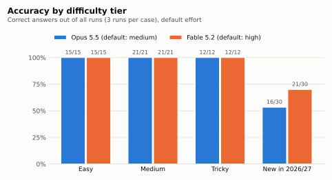
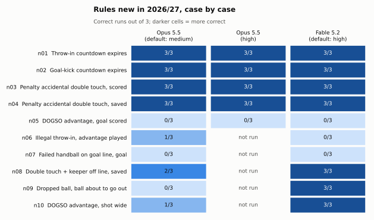
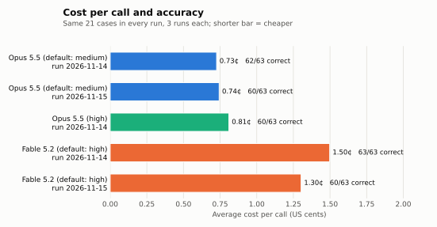
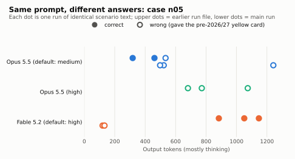

# Results: Opus 5.5 vs Fable 5.2 as a soccer referee

_Generated by `report.py` from the files in `results/`. Do not edit by hand._

Each model answered 26 referee situations (IFAB Laws of the Game 2026/27) three times, returning a decision, the team that gets the restart, and any card. A case counts as correct only if all three match the answer key.

## Summary

| Configuration | Correct | Accuracy | Median latency | p90 latency | Avg output tokens | Cost per call | Total cost |
|---|---|---|---|---|---|---|---|
| Opus 5.5 (default: medium) | 64/78 | 82% | 2.6 s | 10.0 s | 340 | $0.0092 | $0.72 |
| Fable 5.2 (default: high) | 69/78 | 88% | 2.8 s | 6.4 s | 283 | $0.0162 | $1.26 |

Source: `results/20261115-191815.jsonl`. Prices: Opus 5.5 $4 / $20 and Fable 5.2 $8 / $40 per million input / output tokens; output tokens include thinking.

## Accuracy by tier

<picture>
  <source media="(prefers-color-scheme: dark)" srcset="docs/charts/accuracy-by-tier-dark.svg">
  
</picture>

## Rules new in 2026/27

<picture>
  <source media="(prefers-color-scheme: dark)" srcset="docs/charts/new-rules-grid-dark.svg">
  
</picture>

| Case | Situation | Expected | Opus 5.5 (default: medium) | Opus 5.5 (high) | Fable 5.2 (default: high) |
|---|---|---|---|---|---|
| n01 | Throw-in countdown expires | throw_in / blue / none | 3/3 | 3/3 | 3/3 |
| n02 | Goal-kick countdown expires | corner_kick / red / none | 3/3 | 3/3 | 3/3 |
| n03 | Penalty accidental double touch, scored | retake / red / none | 3/3 | 3/3 | 3/3 |
| n04 | Penalty accidental double touch, saved | indirect_free_kick / blue / none | 3/3 | 3/3 | 3/3 |
| n05 | DOGSO advantage, goal scored | goal / red / none | 0/3 | 0/3 | 0/3 |
| n06 | Illegal throw-in, advantage played | play_on / none / none | 1/3 | not run | 0/3 |
| n07 | Failed handball on goal line, goal | goal / red / none | 0/3 | not run | 0/3 |
| n08 | Double touch + keeper off line, saved | retake / red / none | 2/3 | not run | 3/3 |
| n09 | Dropped ball, ball about to go out | dropped_ball / blue / none | 0/3 | not run | 3/3 |
| n10 | DOGSO advantage, shot wide | goal_kick / blue / yellow | 1/3 | not run | 3/3 |

## Cost and accuracy

<picture>
  <source media="(prefers-color-scheme: dark)" srcset="docs/charts/cost-vs-accuracy-dark.svg">
  
</picture>

| Configuration | Correct | Cost per call | Source |
|---|---|---|---|
| Opus 5.5 (default: medium) | 62/63 | $0.0073 | `results/20261114-004231.jsonl` |
| Opus 5.5 (default: medium) | 60/63 | $0.0074 | `results/20261115-191815.jsonl` |
| Opus 5.5 (high) | 60/63 | $0.0081 | `results/20261114-005008.jsonl` |
| Fable 5.2 (default: high) | 63/63 | $0.0150 | `results/20261114-004231.jsonl` |
| Fable 5.2 (default: high) | 60/63 | $0.0130 | `results/20261115-191815.jsonl` |

Only the 21 cases present in every run are compared here. The two default-effort runs used identical prompts, so the gap between them is run-to-run variation.

## Run-to-run variation on n05

<picture>
  <source media="(prefers-color-scheme: dark)" srcset="docs/charts/n05-variance-dark.svg">
  
</picture>

_Red is attacking Blue's goal. Outside the penalty area, a Blue defender carelessly trips a Red attacker, denying an obvious goal-scoring opportunity. The ball runs to another Red attacker, the referee plays advantage, and that attacker immediately scores._

| Configuration | Run file | Correct | Output tokens per run |
|---|---|---|---|
| Opus 5.5 (default: medium) | `results/20261114-004231.jsonl` | 2/3 | 461, 534, 318 |
| Fable 5.2 (default: high) | `results/20261114-004231.jsonl` | 3/3 | 1147, 1051, 884 |
| Opus 5.5 (default: medium) | `results/20261115-191815.jsonl` | 0/3 | 522, 1242, 498 |
| Fable 5.2 (default: high) | `results/20261115-191815.jsonl` | 0/3 | 120, 131, 133 |
| Opus 5.5 (high) | `results/20261114-005008.jsonl` | 0/3 | 1074, 681, 772 |

## Every miss (main run)

Opus 5.5 (default: medium): 14 misses

| Case | Got | Expected | Model's explanation |
|---|---|---|---|
| n05 | sanction=yellow | sanction=none | The goal stands because advantage was applied. Under Law 12, when advantage is played for a DOGSO offence and a goal results, the offender is not sent off; instead they are cautioned for unsporting behaviour when the ball is next out of play. |
| n05 | sanction=yellow | sanction=none | The referee correctly applied advantage and the goal stands (Law 10/Law 12), with play restarting with a Blue kick-off. Under Law 12, when advantage is played after a DOGSO offence and a goal results, the offender is not sent off but is cautioned for unsporting behaviour. |
| n05 | sanction=yellow | sanction=none | The goal stands because the referee correctly applied advantage. Under Law 12, when advantage is played for a denial of an obvious goal-scoring opportunity and a goal is scored, the offender is not sent off but is cautioned for unsporting behaviour. |
| n06 | decision=throw_in, awarded_to=blue | decision=play_on, awarded_to=none | Under Law 15, the thrower must keep part of each foot on the touchline or the ground outside it. An improperly taken throw-in is a procedural restart infringement, not a foul, so advantage is not applied and the throw-in is retaken by the opposing team. Blue is therefore awarded the throw-in from the same place, with no disciplinary sanction. |
| n06 | decision=throw_in, awarded_to=blue | decision=play_on, awarded_to=none | Under Law 15, the thrower must have part of each foot on the touchline or on the ground outside the field; lifting both feet makes the throw-in incorrect. The throw-in is then retaken by the opposing team (Blue). Advantage does not apply to an incorrectly taken throw-in because it is a procedural infringement, not a foul, and there is no disciplinary sanction. |
| n07 | sanction=yellow | sanction=none | Under Law 12, when a player denies or attempts to deny a goal by a deliberate handball and the goal is still scored, the referee allows the goal (advantage). Because the goal stands, the sending-off for DOGSO does not apply. The defender is instead cautioned (yellow card) for unsporting behaviour for the attempted handball. |
| n07 | sanction=yellow | sanction=none | Under Law 12, when a player attempts to deny a goal by deliberate handball but the goal is still scored, the referee allows the goal (advantage) and the offender is cautioned for unsporting behaviour rather than sent off. The goal stands for Red, with a kick-off to Blue, and the Blue defender receives a yellow card. |
| n07 | sanction=yellow | sanction=none | Under Law 12, when a player attempts to deny a goal by deliberate handball but the goal is still scored, the referee allows the goal (advantage) and the offender is cautioned for unsporting behaviour rather than sent off. Play restarts with a kick-off to Blue. |
| n08 | decision=indirect_free_kick, awarded_to=blue | decision=retake, awarded_to=red | Under Law 14, when the kicker accidentally touches the ball with their other foot and the kick is not scored, play restarts with an indirect free kick to the defending team. Where the kicker and goalkeeper both offend, the kicker's offence is penalised, so the goalkeeper's early movement does not lead to a retake. No sanction is given: the kicker's touch was accidental, and the goalkeeper's offence is not penalised. |
| n09 | awarded_to=red | awarded_to=blue | The ball had not yet wholly crossed the touchline, so it was still in play when the referee stopped play for the injury, and no throw-in can be awarded. Under Law 8, play restarts with a dropped ball for Red, the team that last touched it, at the position where it was last touched. All other players must be at least 4 m away. |
| n09 | awarded_to=red | awarded_to=blue | The ball was still in play when the referee stopped for the injury, so it does not matter that it was about to go out. Under Law 8, when play is stopped with no offence outside the penalty area, the ball is dropped for one player of the team that last touched it (Red). The drop is taken at the position where the ball last touched a player, and all other players must be at least 4 m away. |
| n09 | awarded_to=red | awarded_to=blue | The ball was still in play when the referee stopped play for the injury, so under Law 8 the restart is a dropped ball. Since the stoppage was outside the penalty area, the ball is dropped for a player of Red, the team that last touched it, at the position where it was last touched. The fact that the ball was about to go out is irrelevant, and no sanction applies because no offence occurred. |
| n10 | sanction=red | sanction=yellow | The advantage was realised when Red got a shot away, so play restarts with a goal kick to Blue after the ball went out over Blue's goal line. Under Law 12, a sanction withheld during advantage must be issued when the ball is next out of play. The only exception for DOGSO is when the advantage leads to a goal, which reduces it to a caution; since no goal was scored, the Blue defender is sent off. |
| n10 | sanction=red | sanction=yellow | Under Law 12, when advantage is played for an offence that would have been a sending-off, the sanction must still be issued when the ball next goes out of play; the reduction to a caution applies only if the advantage results in a goal. Because the DOGSO offence was outside the penalty area and the shot went wide, the Blue defender is sent off. Play restarts with a goal kick to Blue, as Red last touched the ball before it crossed Blue's goal line (Law 16). |

Fable 5.2 (default: high): 9 misses

| Case | Got | Expected | Model's explanation |
|---|---|---|---|
| n05 | sanction=yellow | sanction=none | Under Law 12, when the referee plays advantage for a DOGSO offence, the offender is not sent off but is cautioned for unsporting behaviour; because advantage was applied and the goal was scored, the goal stands and the Blue defender receives a yellow card. |
| n05 | sanction=yellow | sanction=none | Law 12: when the referee plays advantage for a DOGSO offence and a goal is scored, the goal stands and the offender is cautioned for unsporting behaviour rather than sent off, since the goal-scoring opportunity was not ultimately denied. Restart is a kick-off to Blue. |
| n05 | sanction=yellow | sanction=none | Under Law 12, when the referee plays advantage for a DOGSO offence and a goal is scored, the goal stands and the offender is cautioned for unsporting behaviour rather than sent off, since the goal-scoring opportunity was not ultimately denied. Restart is a kick-off to Blue. |
| n06 | decision=throw_in, awarded_to=blue | decision=play_on, awarded_to=none | Under Law 15, the thrower must have part of each foot on or behind the touchline when delivering the ball, so this throw-in was taken incorrectly. Advantage is not applied to an incorrectly taken throw-in, so play is stopped and the throw-in is awarded to Blue from the same position, with no disciplinary sanction. |
| n06 | decision=throw_in, awarded_to=blue | decision=play_on, awarded_to=none | Under Law 15 the thrower must have part of each foot on or behind the touchline (on the ground) when delivering the ball, so this throw-in was taken incorrectly. Advantage is not applied to an incorrectly taken throw-in, so play is stopped and the throw-in is awarded to Blue from the same spot, with no disciplinary sanction. |
| n06 | decision=throw_in, awarded_to=blue | decision=play_on, awarded_to=none | Under Law 15 the thrower must have part of each foot on the touchline or on the ground outside it, so Red's throw-in was taken incorrectly. Advantage is not applied to an incorrectly taken throw-in; the throw-in is awarded to the opposing team (Blue) from the same spot, with no disciplinary sanction. |
| n07 | sanction=yellow | sanction=none | Under Law 12, the referee applies advantage and the goal stands because the ball entered the net despite the deliberate handball. As the attempt to deny the goal failed, the Blue defender is cautioned for unsporting behaviour rather than sent off for DOGSO. |
| n07 | sanction=yellow | sanction=none | The ball entered the goal despite the deliberate handball, so advantage applies and the goal stands (Law 10). Under Law 12, the Blue defender is cautioned for unsporting behaviour for handling the ball in an unsuccessful attempt to prevent a goal; it is not a sending-off because the goal was not denied. |
| n07 | sanction=yellow | sanction=none | Advantage is applied and the goal stands because the ball entered the goal despite the deliberate handball (Law 5, Law 10). Under Law 12 the defender is cautioned for unsporting behaviour for handling the ball in an unsuccessful attempt to prevent a goal; it is not a sending-off because the goal was not denied. |

